<a id="readme-top"></a>

<div align="center">

<picture>
  <source media="(prefers-color-scheme: dark)" srcset="docs/design/banner-dark.png">
  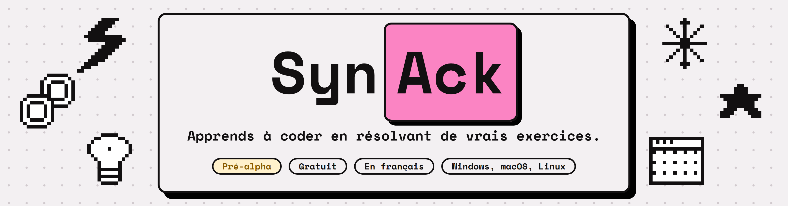
</picture>

<br>

**Une application de bureau gratuite et en français pour apprendre à coder.**<br>
Tu écris ta solution, SynAck la compile et l'exécute avec **les vrais compilateurs de ton ordinateur**, puis la vérifie pour de bon.

<br>

[](https://github.com/iSweat-exe/SynAck-App/releases)
[](https://github.com/iSweat-exe/SynAck-App/actions/workflows/ci.yml)


<br>

[Pourquoi SynAck](#pourquoi) &nbsp;|&nbsp;
[Captures](#captures) &nbsp;|&nbsp;
[Vérification](#verification) &nbsp;|&nbsp;
[Installer](#installer) &nbsp;|&nbsp;
[Développer](#developper) &nbsp;|&nbsp;
[Feuille de route](#feuille-de-route)

</div>

<br>

<picture>
  <source media="(prefers-color-scheme: dark)" srcset="docs/screenshots/exercises-dark.png">
  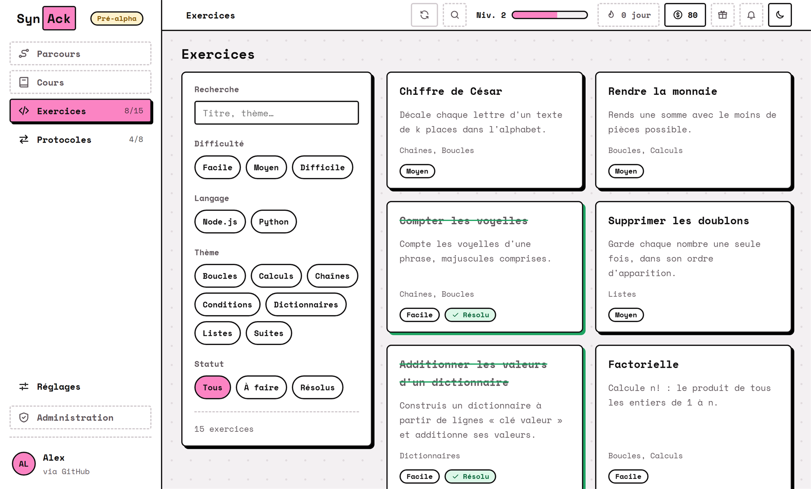
</picture>

> [!NOTE]
> SynAck est en **pré-alpha** : il fonctionne, mais tout peut encore changer. Le projet est mené par une seule personne, une fonctionnalité à la fois.

<a id="pourquoi"></a>

## Pourquoi SynAck

La plupart des sites d'exercices exécutent ton code sur leurs serveurs et te montrent un « bravo » vert. SynAck fait autrement : **tout se passe sur ta machine**, avec les mêmes outils que ceux que tu utiliseras pour de vrai.

|                                          |                                                                                                                                                                                          |
| ---------------------------------------- | ---------------------------------------------------------------------------------------------------------------------------------------------------------------------------------------- |
| **De vrais compilateurs**                | Python, Node.js, Go, Rust, C et C++ sont détectés sur ton ordinateur. Pas de bac à sable en ligne : tu apprends avec l'outil réel, ses messages d'erreur compris.                        |
| **Impossible de « sauter » un exercice** | Les tests qui valident sont **cachés** et **tirés au hasard** à chaque validation. Coder les réponses en dur ne marche pas, même celles des exemples. [Comment ça marche](#verification) |
| **Des pièges, pas des formalités**       | Liste vide, clé répétée dans un dictionnaire, nombres négatifs, majuscules : les énoncés contiennent les vraies embûches de logique, et les tests les exercent.                          |
| **Les protocoles réseau, animés**        | HTTP, HTTPS, TLS, DNS, TCP, UDP, SSH et IPC expliqués avec des schémas qui se dessinent pas à pas, avec une perte de paquet à simuler. Chacun se valide par un quiz.                     |
| **Une progression qui se voit**          | Niveau, XP, pièces, exercices barrés en vert, animations de réussite. Une boutique est en route.                                                                                         |
| **Ton travail reste chez toi**           | La progression est enregistrée **sur ton ordinateur** (SQLite). La connexion passe par ton navigateur : SynAck ne voit jamais ton mot de passe.                                          |
| **À jour tout seul**                     | Les mises à jour viennent des releases GitHub, **signées** et vérifiées avant d'être installées. Rien ne se télécharge sans ton clic.                                                    |

<p align="right">(<a href="#readme-top">retour en haut</a>)</p>

<a id="captures"></a>

## Captures

### Un exercice, et ce que tu ne vois pas

L'énoncé d'un côté, l'éditeur (Monaco, celui de VS Code) de l'autre. Un exercice déjà résolu garde une bannière visible pendant que tu défiles, et le bouton **Réinitialiser le code** remet le code de départ sans toucher à ta progression.

<picture>
  <source media="(prefers-color-scheme: dark)" srcset="docs/screenshots/exercise-dark.png">
  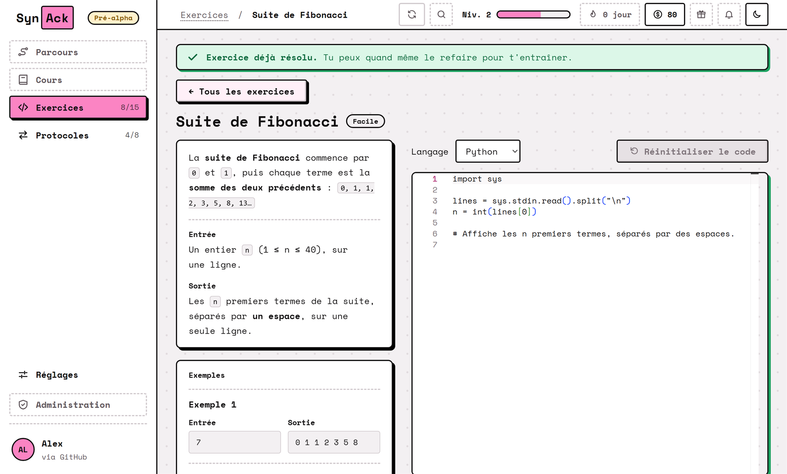
</picture>

### Réussir se remarque

Une validation réussie lance une petite fête : la barre d'XP se remplit, la pièce tourne, et le panneau de réussite dit ce que tu as gagné. Si tu préfères moins de mouvement, tout s'affiche directement.

<div align="center">
<picture>
  <source media="(prefers-color-scheme: dark)" srcset="docs/screenshots/success-dark.png">
  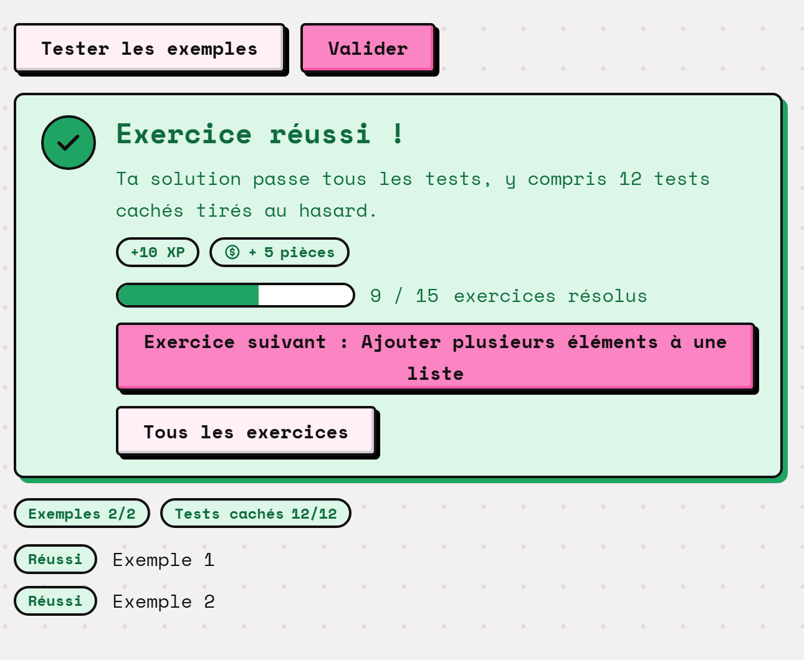
</picture>
</div>

### Les protocoles, pas à pas

Un schéma de séquence qui se construit pendant la lecture : une flèche se trace, un paquet voyage, l'étiquette apparaît. Tu peux avancer, reculer, ou **simuler la perte d'un paquet** pour voir ce que fait TCP.

<picture>
  <source media="(prefers-color-scheme: dark)" srcset="docs/screenshots/protocol-dark.png">
  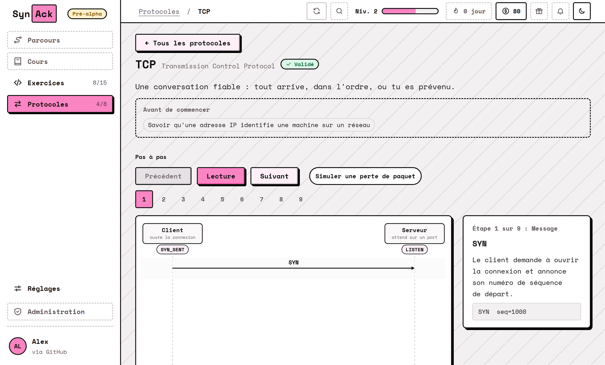
</picture>

### La boutique

Les pièces gagnées en résolvant des exercices s'échangeront bientôt contre des thèmes, des bonus et des cadeaux de profil. Les illustrations sont du pixel art en deux tons qui suit le thème clair ou sombre.

<picture>
  <source media="(prefers-color-scheme: dark)" srcset="docs/screenshots/shop-dark.png">
  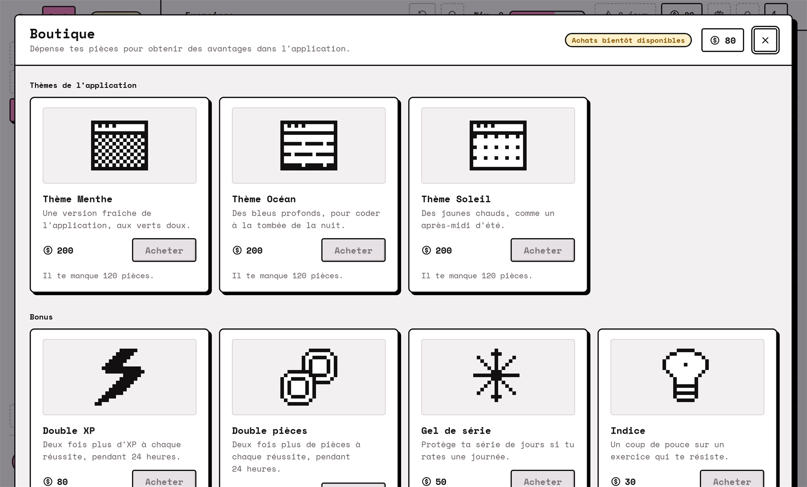
</picture>

> [!NOTE]
> Les achats ne sont pas encore possibles : la fenêtre, le catalogue et ton solde existent, les boutons « Acheter » arrivent plus tard.

### Se connecter, être accueilli

<table>
  <tr>
    <td width="50%">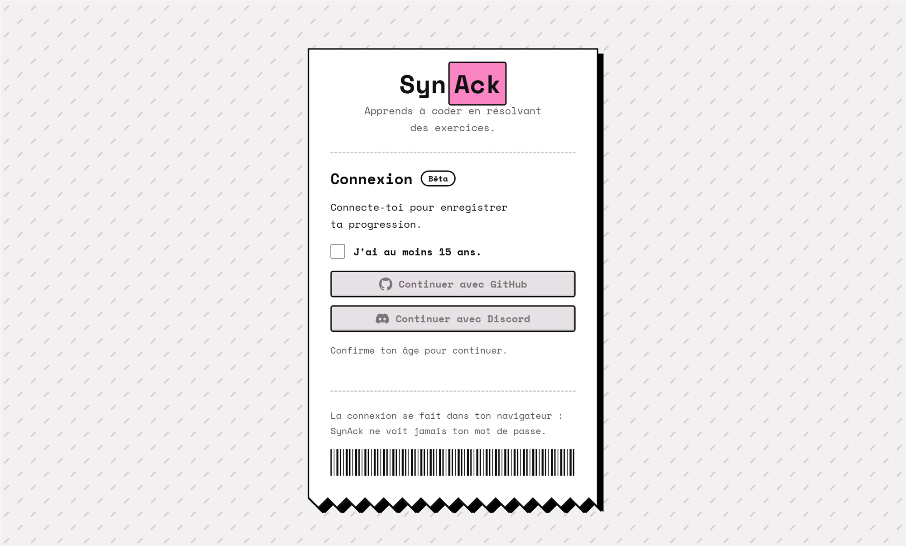</td>
    <td width="50%">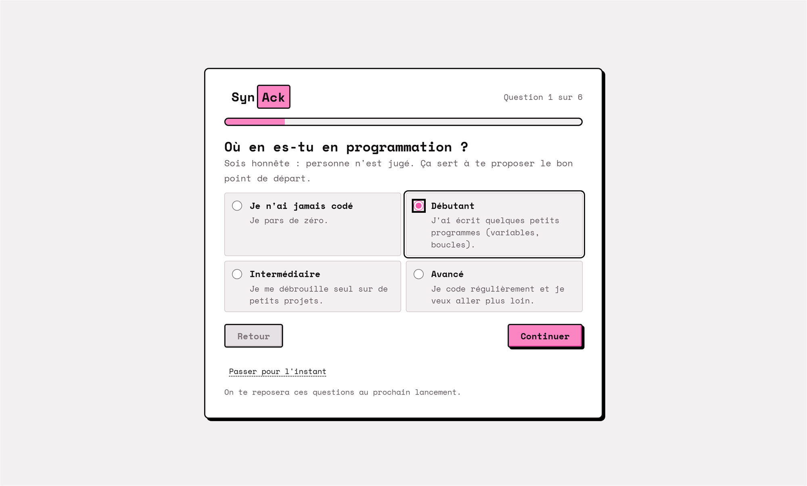</td>
  </tr>
  <tr>
    <td align="center"><sub>Connexion GitHub ou Discord, dans ton navigateur</sub></td>
    <td align="center"><sub>Six questions pour préparer des recommandations</sub></td>
  </tr>
</table>

<p align="right">(<a href="#readme-top">retour en haut</a>)</p>

<a id="verification"></a>

## Comment un exercice est vérifié

C'est le cœur du produit : l'élève doit **faire réellement la logique demandée**. Tout est jugé par le cœur Rust, jamais par l'interface.

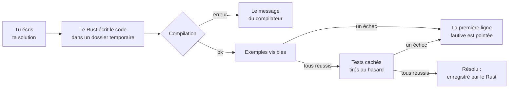

| Garde-fou                      | Ce qu'il empêche                                                                                                                          |
| ------------------------------ | ----------------------------------------------------------------------------------------------------------------------------------------- |
| Tests cachés dans le Rust      | L'interface ne reçoit que l'énoncé, les exemples et le code de départ : elle ne peut pas voir ce qui valide.                              |
| Entrées tirées au hasard       | Quelques cas limites fixes, plus des cas aléatoires, avec une solution de référence qui calcule la sortie attendue.                       |
| Corrigés hors du binaire       | Les solutions de référence ne sont pas embarquées dans l'application, seulement lues par les tests.                                       |
| « Résolu » décidé côté Rust    | Le front ne peut pas déclarer une réussite : un code de départ, un programme vide ou qui plante ne résolvent rien.                        |
| Limites                        | 5 secondes par cas, une sortie plafonnée à 1 Mo par flux, un code de 20 000 octets au plus, et un arrêt après deux dépassements de temps. |
| Les tests se testent eux-mêmes | La suite de tests vérifie que chaque exercice a un générateur, que ses exemples sont cohérents et que les corrigés passent.               |

Les **protocoles** suivent le même principe : le quiz est généré et corrigé par le Rust, il faut **les 8 questions justes** pour valider, et il n'est jamais le même deux fois (sujets, ordre des options et formulation changent, et la négation est retournée : « laquelle est fausse ? »).

<p align="right">(<a href="#readme-top">retour en haut</a>)</p>

<a id="installer"></a>

## Installer

> [!IMPORTANT]
> La première version n'est pas encore publiée. Les installeurs apparaîtront sur la page [**Releases**](https://github.com/iSweat-exe/SynAck-App/releases) dès qu'elle le sera. En attendant, tu peux lancer SynAck [depuis les sources](#developper).

| Système | Format prévu                             |
| ------- | ---------------------------------------- |
| Windows | Installeur `.exe`                        |
| macOS   | `.dmg`, pour Apple silicon et pour Intel |
| Linux   | `.deb` et `.AppImage`                    |

**Ce qu'il te faut pour t'exercer.** SynAck utilise les outils déjà installés sur ta machine. Les exercices actuels se résolvent en **Python** ou en **JavaScript (Node.js)** : installe au moins l'un des deux. La page **Réglages > Environnement** de l'application montre ce qu'elle trouve et explique, système par système, comment installer ce qui manque. Le moteur sait aussi exécuter Go, Rust, C et C++.

<details>
<summary><b>Windows ou macOS affiche un avertissement à la première installation</b></summary>

<br>

Les installeurs ne sont pas encore signés avec un certificat de développeur (Windows) ni notarisés par Apple. SmartScreen ou Gatekeeper peuvent donc te demander de confirmer l'ouverture : c'est attendu pour l'instant. Les **mises à jour**, elles, sont toujours vérifiées avec la clé de signature du projet avant d'être installées.

</details>

<details>
<summary><b>Comment marchent les mises à jour</b></summary>

<br>

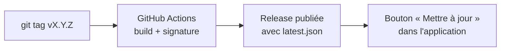

L'application cherche une nouvelle version 5 secondes après son lancement, puis toutes les 6 heures. Quand il y en a une, le bouton de la barre du haut devient rose et affiche le numéro. **Rien n'est téléchargé ni redémarré sans ton clic.** Le fichier téléchargé est vérifié avec la clé publique embarquée dans l'application : un fichier modifié est refusé. Le détail, pour le mainteneur, est dans [`docs/RELEASING.md`](docs/RELEASING.md).

</details>

<p align="right">(<a href="#readme-top">retour en haut</a>)</p>

<a id="developper"></a>

## Développer

### Sous le capot

L'interface ne fait rien de dangereux et ne décide de rien d'important : tout ce qui touche au système passe par des commandes Tauri étroites et typées.

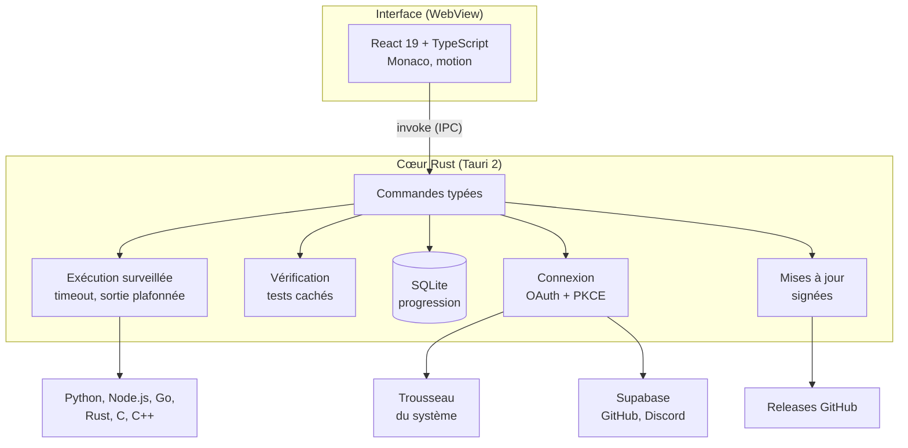

| Couche          | Choix                                                                                                              |
| --------------- | ------------------------------------------------------------------------------------------------------------------ |
| Coquille        | Tauri 2 (WebView2 sous Windows, WebKit ailleurs)                                                                   |
| Interface       | React 19, TypeScript très strict, Vite, [Monaco](https://microsoft.github.io/monaco-editor/) embarqué (pas de CDN) |
| Mouvement       | Transitions de page natives de React, [`motion`](https://motion.dev/) pour le reste                                |
| Données locales | SQLite embarqué (`rusqlite`), migrations par `PRAGMA user_version`                                                 |
| Connexion       | Supabase (GitHub, Discord), OAuth + PKCE dans le navigateur du système, jeton dans le trousseau                    |
| Police          | Space Mono, embarquée                                                                                              |

**Des langages décrits par des données.** Ajouter un langage, c'est ajouter une entrée dans [`languages.json`](src-tauri/languages.json) (détection, commandes de compilation et d'exécution, guide d'installation). Le moteur ne change pas.

### Lancer le projet

Il te faut [Node.js 24](https://nodejs.org/), [Rust (stable)](https://rustup.rs/) et les [prérequis de Tauri](https://v2.tauri.app/start/prerequisites/) pour ton système.

```bash
git clone https://github.com/iSweat-exe/SynAck-App.git
cd SynAck-App
npm install
npm run tauri dev
```

Le premier lancement compile toutes les dépendances Rust, ce qui prend plusieurs minutes. Les suivants sont rapides.

| Commande                       | Ce qu'elle fait                                                                                             |
| ------------------------------ | ----------------------------------------------------------------------------------------------------------- |
| `npm run tauri dev`            | Lance l'application (Vite et fenêtre native)                                                                |
| `npm run check`                | **La vérification complète** : versions, TypeScript, ESLint, Prettier, rustfmt, clippy, tests front et Rust |
| `npm test`                     | Les tests du front seul (Vitest)                                                                            |
| `npm run build`                | Vérifie les types et construit le front                                                                     |
| `npm run build:signed`         | Construit un installeur signé avec la clé de `.secret/` (essai local)                                       |
| `npm run version:set -- 0.2.0` | Change la version dans les 5 fichiers qui la portent                                                        |

### Ajouter un exercice, sans toucher à l'interface

<details>
<summary><b>Voir la marche à suivre</b></summary>

<br>

1. Crée `src-tauri/exercises/<id>/exercise.json` : titre, difficulté, énoncé, formats d'entrée et de sortie, exemples visibles et un code de départ par langage.
2. Ajoute les corrigés `solution.py` et `solution.js` dans le même dossier.
3. Déclare l'exercice dans `exercises.rs`, puis dans `cases.rs` : les entrées de test (cas limites fixes et aléatoires qui exercent les pièges) et la solution de référence.
4. Lance `npm run check` : les tests de cohérence, de corrigés et de triche se lancent seuls, et un exercice cassé fait échouer la commande.

Privilégie des sorties sans ambiguïté entre langages (entiers, mots, pas de décimales à arrondir). Le détail est dans [`CLAUDE.md`](CLAUDE.md).

</details>

### Carte du dépôt

| Dossier      | Contenu                                                                                                                                    |
| ------------ | ------------------------------------------------------------------------------------------------------------------------------------------ |
| `src/`       | L'interface React. Aucune logique système.                                                                                                 |
| `src-tauri/` | Le cœur Rust : exécution, vérification, progression, protocoles, connexion. Les langages, exercices et banques de quiz y sont des données. |
| `supabase/`  | Configuration, migrations et tests de la base partagée, appliqués automatiquement par la CI.                                               |
| `.github/`   | CI, publication par tag, migrations, Dependabot.                                                                                           |
| `scripts/`   | Versions SemVer, notes de version et build signé.                                                                                          |
| `docs/`      | [Feuille de route](docs/ROADMAP.md), [publication des versions](docs/RELEASING.md), identité visuelle.                                     |

### Qualité

Chaque pull request passe `npm run check` sur Windows et sur Linux. Plus de 500 tests couvrent le front et le Rust, y compris des tests qui exécutent **les vrais outils installés** (et se sautent proprement quand l'un manque).

Quelques règles du projet :

- **Une seule fonctionnalité à la fois.** Une idée hors périmètre se note dans la [feuille de route](docs/ROADMAP.md), on ne la commence pas.
- **Le Rust n'utilise jamais `unwrap` ni `panic`** (clippy les refuse), et les erreurs rendues à l'interface sont des messages lisibles en français.
- **Une couleur ne s'écrit jamais en dur** : les composants n'utilisent que des rôles de couleur, et un test vérifie les contrastes des deux thèmes.
- **Aucun secret dans le dépôt.** La clé de signature des mises à jour vit dans `.secret/`, ignoré par git.
- Les commits suivent [Conventional Commits](https://www.conventionalcommits.org/fr/) et les versions suivent le [versionnage sémantique](https://semver.org/lang/fr/).

### Sécurité

- **Le WebView ne voit jamais un jeton.** Il reçoit seulement le nom et l'avatar du compte ; les appels réseau vers Supabase sont faits par le Rust, et la politique de sécurité du contenu (CSP) n'autorise que le canal interne.
- **Connexion d'application native** : OAuth dans le navigateur du système avec PKCE, serveur de rappel local limité à `127.0.0.1`. Seul le jeton de rafraîchissement est conservé, dans le coffre du système (Gestionnaire d'identifiants, Trousseau, Secret Service).
- **Le code de l'élève s'exécute dans un processus enfant surveillé** : dossier temporaire dédié, délai maximal obligatoire, sortie plafonnée.
- Un score ou un résultat envoyé par une application qui tourne sur ta machine est forgeable : un futur classement devra être validé côté serveur.

Tu as trouvé une faille ? Merci de ne pas la publier dans une issue : écris au mainteneur depuis son [profil GitHub](https://github.com/iSweat-exe).

<p align="right">(<a href="#readme-top">retour en haut</a>)</p>

<a id="feuille-de-route"></a>

## Feuille de route

**Déjà là**

- [x] 15 exercices en Python et en JavaScript, vérifiés par des tests cachés aléatoires
- [x] 8 protocoles réseau animés, validés par un quiz différent à chaque essai
- [x] Connexion GitHub et Discord, progression locale, questionnaire de bienvenue
- [x] Niveau, XP, pièces et animations de réussite
- [x] Thème clair et sombre, fil d'Ariane, page de profil
- [x] Mises à jour automatiques signées, CI/CD et migrations de base de données

**Ensuite**

- [ ] Plus d'exercices, puis Go, Rust, C et C++ proposés dans les exercices
- [ ] Brouillons conservés quand on ferme l'application
- [ ] Progression liée au compte (aujourd'hui partagée entre comptes sur un même ordinateur)
- [ ] Boutique : achats, thèmes et bonus pour de vrai
- [ ] Cours, parcours prêts à suivre (« Développeur fullstack »…) et recommandations fondées sur les réponses du questionnaire
- [ ] Série de jours, recherche globale, classement

Le détail et les idées en vrac sont dans [`docs/ROADMAP.md`](docs/ROADMAP.md). Les changements version par version sont dans le [journal des changements](CHANGELOG.md).

<p align="right">(<a href="#readme-top">retour en haut</a>)</p>

## Contribuer

SynAck est un projet personnel et jeune : les idées, les retours et les rapports de bug sont les bienvenus dans les [issues](https://github.com/iSweat-exe/SynAck-App/issues). Avant de proposer du code, lis [`CLAUDE.md`](CLAUDE.md), qui décrit l'architecture et les règles du projet, et lance `npm run check`.

## Remerciements

SynAck repose sur [Tauri](https://tauri.app/), [React](https://react.dev/), [Monaco](https://microsoft.github.io/monaco-editor/), [motion](https://motion.dev/), [Supabase](https://supabase.com/) et la police [Space Mono](https://fonts.google.com/specimen/Space+Mono). Merci aussi aux projets dont les README ont servi d'inspiration à celui-ci : [Sniffnet](https://github.com/GyulyVGC/sniffnet), [Cap](https://github.com/CapSoftware/Cap) et le [Best-README-Template](https://github.com/othneildrew/Best-README-Template).

## Licence

© 2026 iSweat-exe. Aucune licence n'est encore attachée à ce dépôt : tous droits réservés en attendant.

<p align="right">(<a href="#readme-top">retour en haut</a>)</p>
